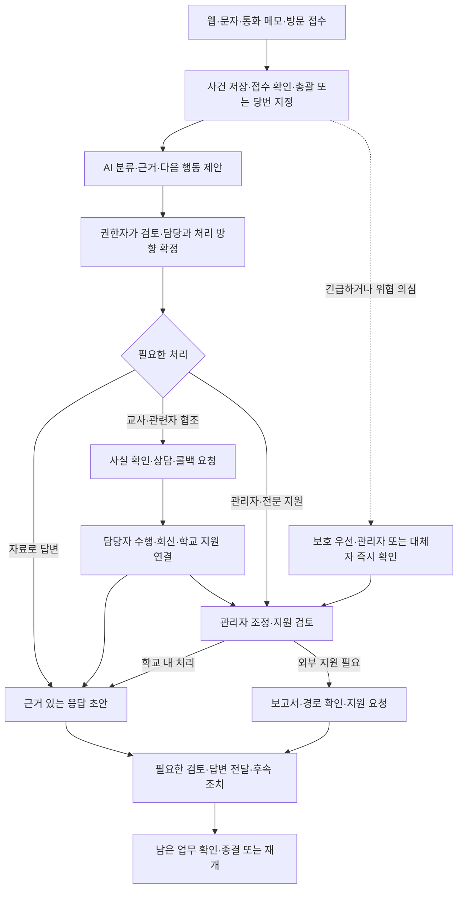
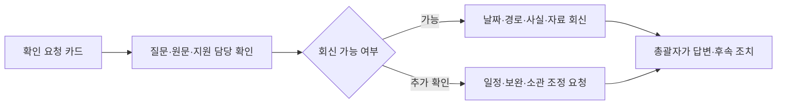
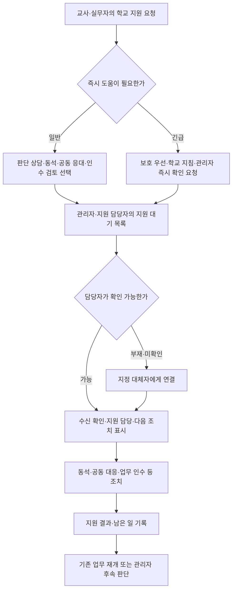
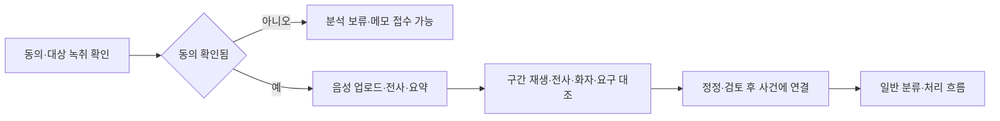

# 학교 민원대응 에이전트 — 유저플로우

> 기준: PRD v2.0·기술 구현 명세·교사 인터뷰 통합본 및 추가 인터뷰 표.
> **교사가 무엇을 해야 하고, 학교에서 누가 함께하며, 어려워졌을 때 어떻게 지원받는지 보이는 흐름.**

이 문서는 사용자의 화면 이동·행동·분기·완료 조건을 정의한다. API 내부 처리 순서는 기술 구현서를 따른다. 특정 구성원 수·학교별 분장·법정 기한을 새로 확정하지 않는다.

## 1. 공통 원칙

1. 접수 단계부터 총괄자 또는 당번·대체 책임자가 있다.
2. AI 분류는 제안이다. 담당 지정·지원 판단·응답은 권한자가 검토한다.
3. 단순 문의는 위임된 권한 내에서 빠르게 처리한다. 모든 건을 교감·교장에게 올리지 않는다.
4. 교사에게 확인·상담·콜백을 요청해도 사건 총괄자는 자동으로 바뀌지 않는다.
5. 요약과 필요한 행동을 먼저 보여주고, 필요한 원문·학교 지원 담당을 함께 제공한다.
6. 위협 의심·긴급 도움은 일반 분류·승인·AI 생성 완료를 기다리지 않는다.
7. 반복 횟수·감정·신고 표현만으로 자동 이관하지 않는다.
8. 지원 요청·보고서 생성·제출·수신·종결을 서로 다른 상태로 관리한다.
9. 사건의 상태와 개별 업무·지원·검토 상태를 구분한다.
10. 모든 주요 행동은 사건 이력에 남고 새 증거·재문의는 기존 기록과 연결한다.

## 2. 역할별 시작 화면

| 사용자 | 기본 진입 | 먼저 확인할 것 | 핵심 행동 |
|---|---|---|---|
| 교무실무사·접수 담당 | 접수·학교 업무 목록 | 새 연락·분류 대기·단순 문의 | 접수·자료 검색·초기 분류·보고 |
| 교감·대응팀 | 학교 업무 현황 | 즉시 확인·분류·지원·답변 대기 | 총괄/업무 배정·협의·검토·지원 |
| 교장 | 주요 사건·지원 판단 | 대응 한계·필요 결정·학교 조치 | 공동 대응·외부 지원·이관 판단 |
| 부장·행정실·관련 담당 | 내 업무·참여 사건 | 소관 확인·복합 민원·협의 요청 | 회신·공동 처리·지원 |
| 담임·교과교사 | 내 확인·상담·대응 요청 | 요청 종류·콜백 여부·필요 시점·지원 담당 | 확인·상담·콜백·지원 요청 |
| 보호자 | 모바일 접수·내 사건 | 접수 여부·진행·예정일·답변 | 접수·보완·상담·추가 문의 |
| 학교 설정 권한자 | 학교 설정 | 분장·대체자·권한·자료·알림 | 설정·근거 자료 갱신 |

‘학교 업무 현황’과 ‘내 업무’는 같은 사건을 서로 다른 권한과 관점으로 보여준다. 역할 전환 시연은 실제 인증·권한 통제와 구분한다.

## 3. 전체 플로우

세 갈래는 배타적이지 않다. 복합 민원은 정보 답변·교사 협조·관리자 지원을 병행한다. 긴급 도움은 접수 화면뿐 아니라 사건·교사 업무 화면에서도 요청 가능하다. 종결된 사건에 추가 사실이 오면 재개하거나 연결 사건을 만든다.

## UF-01. 접수 담당자의 등록·초기 분류

**시작:** 교무실에 전화·문자·방문이 오거나 교사가 받은 연락을 학교 사건으로 등록한다.

| 순서 | 사용자·화면 | 행동 | 화면 결과·다음 단계 |
|---|---|---|---|
| 1 | 접수 담당·신규 접수 | 경로 선택, 원문/메모 입력 | 문자·유선 메모·방문·웹 출처 보존 |
| 2 | 동일 화면 | 일시·보호자·학생·내용·종류의 기본 정보 확인 | 모르는 항목은 미상, 긴급 접수는 최소 입력 가능 |
| 3 | 동일 화면 | **접수 저장** | 접수번호·접수 확인·총괄/당번·예정 안내, 원문 저장 |
| 4 | 분류 검토 | **분류 제안 보기** | AI 유형·긴급도·담당 후보·핵심 요구·부족 정보·근거 |
| 5 | 분류 검토 | 원문과 비교하여 수정·확정 또는 보고 | 아래 세 갈래·필요 시 복수 선택 |

분기:

- **접수 담당자가 자료로 답변 가능:** UF-03으로 이동.
- **담임·관련자의 사실 확인/상담 필요:** 권한 범위에 따라 총괄자에게 보고 후 UF-04.
- **담당이 모호하거나 조정·지원 필요:** UF-02.
- **위협·신변 위험 의심:** AI 결과와 무관하게 UF-05의 긴급 지원.
- **내용 부족:** 필요한 항목만 보완 요청하고 사건은 보존.

**완료:** 접수된 사건, 관리할 사람, 다음 행동이 확인된다. AI 실패 시에도 원문·사건이 남고 수동 분류·보고 가능하다.

## UF-02. 관리자의 보고 검토·배정·조정

**시작:** 분류 검토·학교 업무 현황의 대기 항목 또는 즉시 확인 알림.

1. 관리자는 사건을 열고 **일시·보호자·학생·내용·유형**과 필요한 결정을 본다.
2. 원문·학교 자료·이전 대응·교사 의견·AI 추천의 이유를 확인한다.
3. 필요하면 **대응팀 의견 요청**으로 사건 참여자에게 공유한다.
4. 유형·긴급도·총괄자·업무 수행자·지원 담당·예정일을 수정/확정한다.
5. 처리 방향과 콜백 필요 여부(필요/불필요/판단 대기)를 기록한다.
6. 관련 담당자와 대응 방향을 협의하고 업무를 보낸다.

| 판단 | 다음 행동 |
|---|---|
| 단순 정보 답변 | UF-03, 위임된 권한으로 진행 |
| 사실만 필요 | UF-04-A, 확인 질문만 전달 |
| 생활지도 심층 상담·콜백 필요 | UF-04-B, 맥락·학교 지원과 함께 전달 |
| 교육·행정 복합 | 요구를 나눠 여러 담당자에게 요청, 총괄자는 유지 |
| 학교 내 지원 필요 | UF-05 |
| 반복·새 증거 검토 필요 | UF-06 |
| 외부 지원 필요 | UF-07 |

**부재·인계:** 담당자가 없으면 지정 대체자에게 연결한다. 총괄 인계는 사유·남은 업무와 함께 요청하고 새 담당이 **인수 확인**한다. 확인 전까지 기존/대체 책임자를 표시한다.

**완료:** ‘누가 총괄하고, 누가 무엇을 하며, 누가 지원하고, 다음 결정은 무엇인지’가 정해진다. 모든 사건에 교감·교장 전원 승인을 요구하지 않는다.

## UF-03. 근거 답변·검토·전달

**시작:** 학교 자료로 답변 가능하거나 확인 회신이 준비됨.

1. 담당자는 **응답 작성**을 열고 공지·규정·학사일정의 관련 구간을 본다.
2. **초안 생성** 후 답변의 각 주장과 근거를 비교한다.
3. 필요하면 **표현 다듬기**를 누르고 변경 전후의 사실·날짜·약속이 같은지 확인한다.
4. 미확인 내용은 추가 확인으로 돌리고 준비된 내용은 저장한다.
5. 학교의 검토 범위에 따라 직접 확정하거나 지정 검토자에게 요청한다.
6. 승인된 버전으로 답변을 준비하고, 연결된 수단으로 전달하거나 담당자가 실제 전달 사실을 기록한다.
7. 후속 약속·전달 결과를 확인한 후 UF-11로 이동한다.

예외:

- 근거가 없으면 ‘확인 후 안내’와 보완 업무를 만든다. 출처를 생성하지 않는다.
- 승인 후 내용을 바꾸면 필요한 재검토를 받는다.
- 전달 실패는 실패로 남기고 재시도·다른 경로를 정한다.
- 실제 발송 기능이 없으면 **전달 준비/수동 전달 기록**으로 표시한다.
- 정보 질문과 우려 행동이 함께 있으면 답변 가능한 내용과 지원 검토를 병행한다.

**교사 화면:** 필요 업무가 없으면 카드를 보내지 않거나 ‘조치 불필요—대응팀 처리 중’으로 표시한다.

## UF-04. 교사의 확인·상담·콜백

### 공통 진입

교사는 지정 알림 또는 **내 확인·상담·대응 요청**에서 카드를 연다.

필수 카드 정보:

- 요약·요청 종류·할 일·필요한 시점
- **콜백 필요 여부와 이유**
- 기존 대응·관리자가 검토한 방향
- 사건 총괄자·학교 지원 담당
- 관련 원문 펼치기·이력·첨부
- 회신·일정 조정·학교 지원 요청

복잡한 생활지도 불만·폭언 원문은 경고 후 접어두고 필요한 참여자가 확인할 수 있게 한다.

### A. 사실 확인

교사의 **회신 완료**는 개별 업무 완료다. 사건 종결이나 총괄 인수가 아니다.

### B. 학생 상담·보호자 콜백

1. 교사는 목적·맥락·학교 지원을 확인한다.
2. 가능한 일정을 확인하거나 **일정 조정/원문 보완/지원 요청**을 한다.
3. 필요한 경우 관리자·부장과 대응 방향·동석을 협의한다.
4. 학교 업무 경로로 상담·콜백을 수행한다.
5. 간단한 결과·약속·추가 확인을 기록한다.
6. 총괄자가 후속 업무·추가 답변·종결을 확인한다.

상담 중 위협·어려움이 발생하면 언제든 UF-05로 진입한다. ‘생활지도니까 담임이 전부 처리’ 또는 ‘교사에게는 연락을 무조건 금지’라는 흐름은 사용하지 않는다.

## UF-05. 학교 지원·보호 우선·동석·대체

**핵심 가치가 드러나는 흐름이다.** 교사뿐 아니라 접수 담당자도 요청할 수 있다.

요청자는 ‘요청됨’만 보는 것이 아니라 **누가 확인했고 무엇을 할지** 확인한다. 인수가 필요하면 UF-02의 인수 확인을 거친다.

위협 의심 시 불만의 정당성을 먼저 확정할 때까지 보호를 미루지 않는다. 관리자에게 우선 확인을 요청하고 권한자가 학교 지침에 따라 상담 중단·분리·동석 등 조치를 실행한다. 앱이 자동 통화 종료·출입 제한·신고를 하지 않는다. 실제 현장 도움은 기존 비상체계와 함께 사용한다.

일반 알림은 수업 시간·쉬는 시간·방과 후 설정을 따른다. 긴급은 ‘수업 전만’이라는 고정 시간이 아니라 **지금 또는 지정된 시점에 필요한 도움**으로 처리한다.

## UF-06. 반복·재문의·추가 증거

**시작:** 새 접수에서 관련 사건 후보가 있거나 총괄자가 이력 비교를 연다.

1. 담당자는 AI가 제안한 관련 사건을 확인한다.
2. 연결 유형을 **중복 접수/동일 사안/추가 증거/관련 사안/무관** 중 선택한다.
3. 요구 변화·답변/전달·미이행 약속·새 증거·폭언/위협/부당 요구 검토 신호를 함께 본다.
4. 필요하면 공문 번호·발행기관·일자·첨부를 추가하고 원문 상세를 기록한다.
5. 관리자 또는 권한자가 다음 대응을 결정한다.

| 상황 | 다음 흐름 |
|---|---|
| 학교가 실질 답변을 하지 않음 | 답변 담당·예정일 지정→진행 안내→UF-03 |
| 약속한 조치가 남음 | 후속 업무 우선 수행→진행 안내 |
| 새 사실·증거 추가 | 확인 업무 또는 사건 재개→UF-04/11 |
| 정당성 판단이 불확실 | 추가 확인·공동 검토, 성급한 결론 보류 |
| 우려 행동·교직원 보호 필요 | 보호 지원 UF-05와 내용 검토 병행 |
| 학교 내 대응 한계·전문 지원 필요 | UF-07 |

**운영 설정안:** 30일·동일 사안 후보 3회는 검토 배지 기준이며 자동 이관 기준이 아니다. 실질 답변 없이 24시간 경과 알림은 예정일·휴일·업무시간과 함께 보여주는 확인 신호다. 접수 확인 문구만으로 실질 답변 완료 처리하지 않는다.

## UF-07. 관리자 판단·교육지원청 지원·이관

1. 관리자가 사건의 사실·미확인 사항·학교 노력·이전 답변·관련 매뉴얼을 확인한다.
2. 추가 응답/학교 공동 대응/전문 지원/지원청 이관 중 필요한 대안을 검토한다.
3. 권한자가 사유·대상·요청 지원·학교 후속 담당을 결정한다.
4. **보고서 생성**으로 사건 경과·공문·첨부를 불러온다.
5. 미확인·누락·기관 양식을 보완하고 보고서·첨부를 검토한다.
6. 실제 사용 가능한 경로를 선택한다.
7. 전달·보고·수신 상태를 기록하고 남은 학교 협조 업무를 관리한다.

| 경로 | 사용자 행동 | 표시할 결과 |
|---|---|---|
| 공문 | 승인된 파일 준비·공식 경로 사용·번호 기록 | 생성/내보내기와 제출·수신 구분 |
| 구두 보고 | 대상·시각·내용·보고자·후속 문서 기록 | 구두 보고됨. 공식 이관 완료와 구분 |
| 지역 온라인 창구 | 확인된 기관·사용 조건에 따라 진행 | 실제 접수 결과를 확인한 범위만 기록 |

생활지도·학폭 등은 필요한 민원/생활지도/교육활동 보호 담당 안내를 제공하되 해당 공식 절차를 대체하지 않는다. 교원119 등은 관할에 실제 존재하고 사용 가능한지 확인한 후 설정한다.

긴급 지원은 보고서 완성을 기다리지 않고 최소 정보로 우선 요청하고 문서를 사후 보완할 수 있다. 단순 반복·신고 의사만으로 악성을 확정하거나 자동 외부 전송하지 않는다.

**완료:** 필요한 지원 요청의 진행·증빙·학교 후속 담당이 연결된다. 외부 요청 자체로 사건을 자동 종결하지 않는다.

## UF-08. 다국어·동의 녹취 입력

### A. 다국어 민원

외국어 입력→언어 확인→한국어 작업 번역→원문/번역의 요구·인물·날짜·부정 확인→정정/검토→일반 사건 흐름→확인된 답변을 원문 언어로 번역→검토→전달 준비.

불확실하면 보호자 보완 또는 가능한 검토자에게 확인한다. 번역의 검토 상태를 보여주고 원문을 보존한다. 번역문을 수정하면 연결된 초안의 재확인을 요청한다.

### B. 동의 녹취

화자 불명·잡음은 미상/불확실로 표시한다. ‘발화한 내용’과 사건의 확인 사실은 구분한다. 메모로 접수했다면 녹취 요약 완료로 세지 않는다. 분석 실패해도 사건·원본·동의 상태를 보존하고 재시도 가능 여부를 안내한다.

## UF-09. 관리자 지원 대시보드

1. 관리자는 기간·학교 범위·민원/상담 포함 여부를 선택한다.
2. 단계별 대기·지원 미확인·업무 집중·기록된 직접 응대·업무시간을 확인한다.
3. 필요한 항목을 눌러 권한 있는 근거 사건·업무로 이동한다.
4. 담당 조정·동석·공동 응대·대체 지원을 배정한다.
5. 조치 후 지원 상태와 업무 분포를 다시 확인한다.

사건 경과시간과 교사 실제 업무시간을 구분하고 미기록을 표시한다. 교사 순위·성과점수·자동 소진 진단을 제공하지 않는다. 대시보드의 목적지는 지원 행동이다.

## UF-10. 보호자의 접수·진행·상담·추가 문의

1. 보호자가 모바일 웹에서 접수·상담 요청을 선택한다.
2. 필요한 본인 확인·관계를 확인하고 내용·첨부를 제출한다.
3. 접수번호·접수 확인·회신 예정일·추가 자료 제출 방법을 확인한다.
4. 내 사건에서 ‘확인 중/답변 준비/상담 일정/답변 등록’ 등 대외 상태를 확인한다.
5. 보완 자료·새 증거·추가 문의를 기존 사건에 제출하거나 상담 일정을 요청한다.
6. 답변을 확인하고 추가 확인이 필요하면 같은 사건에서 이어서 문의한다.

직원이 대신 등록한 전화·문자 사건도 관계 확인 후 연결할 수 있다. 본인 확인 전에는 사건번호만으로 상세를 보여주지 않는다. 내부 검토·교사 지원 현황·타인 정보는 공개하지 않는다. 예정일이 달라지면 이유와 새 예정일을 안내한다.

## UF-11. 후속 업무·종결·재개

1. 총괄자는 답변 전달·상담 결과·지원 진행·남은 약속을 확인한다.
2. 남은 업무가 있으면 완료/취소/다른 담당에게 인계 중 처리 방식과 사유를 정한다.
3. 새 담당이 인수하거나 업무가 정리되면 결과·다음 절차를 보호자에게 안내한다.
4. **종결**하고 사건·원문·이력을 보존한다.
5. 추가 문의·새 증거가 접수되면 기존 사건 재개 또는 연결 사건 생성을 선택한다.

교사의 회신 완료, 답변 초안 승인, 보고서 내보내기는 종결과 다르다. 추가 증거 때문에 재개해도 이전 결정·종결 기록을 삭제하지 않는다.

## UF-12. 학교 설정·자료 갱신

설정 권한자→업무분장·총괄/지원 대체자·답변 검토 범위·알림·기간/횟수·학교 자료·서식 확인→변경안 저장→권한과 적용 범위 검토→새 버전 적용→기존 이력 보존.

규정·공지·일정은 기준일·학교·검토 상태를 표시한다. 구버전과 충돌하면 담당자가 확인한다. 자료 관리 권한만으로 모든 민원 원문 열람 권한을 부여하지 않는다.

## 4. 화면 간 이동 계약

| 화면/경로 예시 | 주요 버튼 | 이동·변화 |
|---|---|---|
| 접수 `/intake` | 접수 저장·긴급 도움 | 사건 저장→상세, 긴급은 지원 경로 우선 |
| 학교 목록 `/cases` | 분류 검토·지원 확인·지연 확인 | 해당 사건의 필요한 탭 |
| 사건 `/cases/:id` | 보고·협의·업무 요청·답변·지원 | 같은 사건에서 관련 작업 수행 |
| 내 업무 `/my-tasks` | 회신·콜백 일정·지원 요청 | 업무 상태 변경·총괄에게 결과 연결 |
| 지원 `/support` | 수신 확인·동석·공동 응대·대체 | 지원 담당·다음 조치 표시 |
| 사건의 답변 탭 | 근거 보기·다듬기·검토 요청 | 출처·변경 비교·승인 대기 |
| 사건의 관련 이력 탭 | 연결·분리·추가 증거 | 유형·공문·확인자·사유 기록 |
| 사건의 보고서 탭 | 생성·내보내기·보고 기록 | 준비·제출·수신·후속 구분 |
| 번역/녹취 탭 | 대조·정정·반영 | 검토된 버전으로 사건 연결 |
| 지원 대시보드 `/dashboard` | 근거 사건·지원 배정 | 권한 범위 사건/업무로 이동 |
| 보호자 `/guardian/cases/:id` | 보완·상담·추가 문의 | 본인 사건 대외 흐름만 표시 |
| 설정 `/settings` | 분장·대체·자료 갱신 | 버전·적용 범위 기록 |

## 5. 예외 흐름

| 상황 | 사용자에게 보일 것 | 다음 행동·책임 |
|---|---|---|
| AI 생성 실패 | 사건은 저장됨·분류 실패·수동 검토 가능 | 접수 담당/총괄이 수동 처리·재시도 |
| 적절한 근거 없음 | 추가 확인 필요·근거 없음 | 담당자 지정·보완·회신 예정 안내 |
| 업무 소관 아님 | 재배정 요청·총괄 유지 | 총괄이 조정, 교사가 새 담당을 혼자 찾게 하지 않음 |
| 담당자 부재 | 대체 담당·확인 대기 | 학교 설정에 따라 연결 |
| 지원 미확인 | 미확인 상태·대체 경로 | 미확인을 숨기지 않고 후속 알림 |
| 수업 중 일반 요청 | 필요한 시점·예약된 알림 | 설정 시간 전달·긴급은 별도 |
| 오래된 화면에서 수정 | 새 버전·충돌 안내 | 최신 내용을 확인하고 다시 검토 |
| 전달 실패 | 실패·재시도/다른 경로 | 담당자와 예정일 유지 |
| 중복 클릭·새로고침 | 기존 접수·기존 실행 상태 | 중복 접수/AI 호출/지원 생성 방지 |
| 권한 없음 | 제한 안내·업무상 접근 요청 경로 | 원문을 먼저 노출하지 않음 |
| 동의·번역·전사 불확실 | 보류/불확실 상태 | 정정·보완, 완료로 가장하지 않음 |

## 6. 레벨·요구사항 연결

| 요구 | 플로우 |
|---|---|
| L1 분류·담당 | UF-01/02 |
| L1 근거 응답 | UF-03 |
| L1 이력 | 전체 흐름의 저장·정정·인계·결정 |
| L2 반복·누적 | UF-06 |
| L2 매뉴얼 근거 이관 | UF-07 |
| L2 톤·과잉 이관 방지 | UF-03/06/07 |
| L3 지원·이관 보고서 | UF-07 |
| L3 교사 노출도·시간 | UF-09 |
| L3 다국어·동의 녹취 | UF-08 |
| 교사 협업·보호 | UF-04/05 |
| 보호자·종결·학교 설정 | UF-10/11/12 |

## 7. 시연에 사용할 흐름

1. **단순 문의:** 문자 등록→학교 공지 근거→검토된 답변→이력. 불필요한 교사 업무 없음.
2. **생활지도 상담:** 관리자 검토→담임 콜백 여부·지원 방향→원문 확인→지원 요청→관리자 확인·동석→결과.
3. **반복·추가 증거:** 미응답 확인 또는 공문·새 증거 연결→필요 대응 결정. 횟수만으로 이관하지 않음.
4. **긴급 방문:** 교감 부재→교장 등 대체 경로→공동 응대→사후 기록.
5. **외부 지원:** 근거·학교 노력→보고서→확인된 경로→후속 학교 업무.
6. **L3 확인:** 다국어 또는 동의된 가상 녹음→검토·사건 연결→지원 대시보드.

**흐름의 마지막 확인:** 요청자가 ‘보냈다’는 사실만 알게 되는가, 아니면 누가 확인했고 무엇을 함께할지까지 알 수 있는가?
